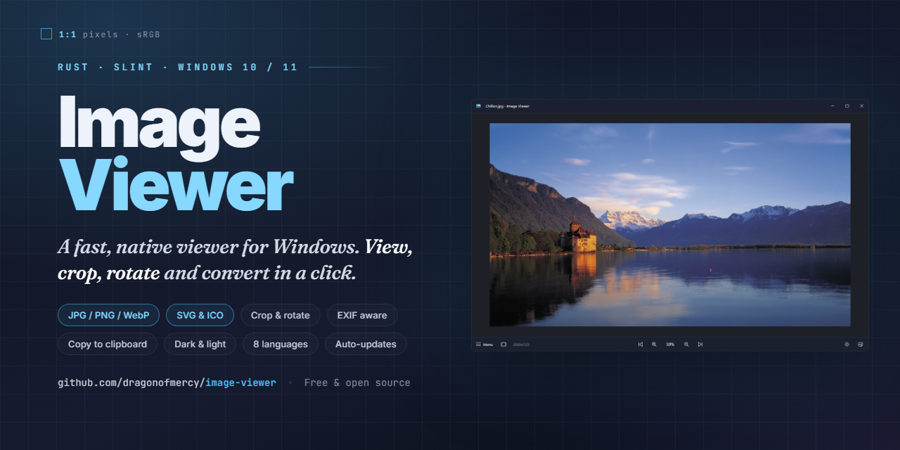
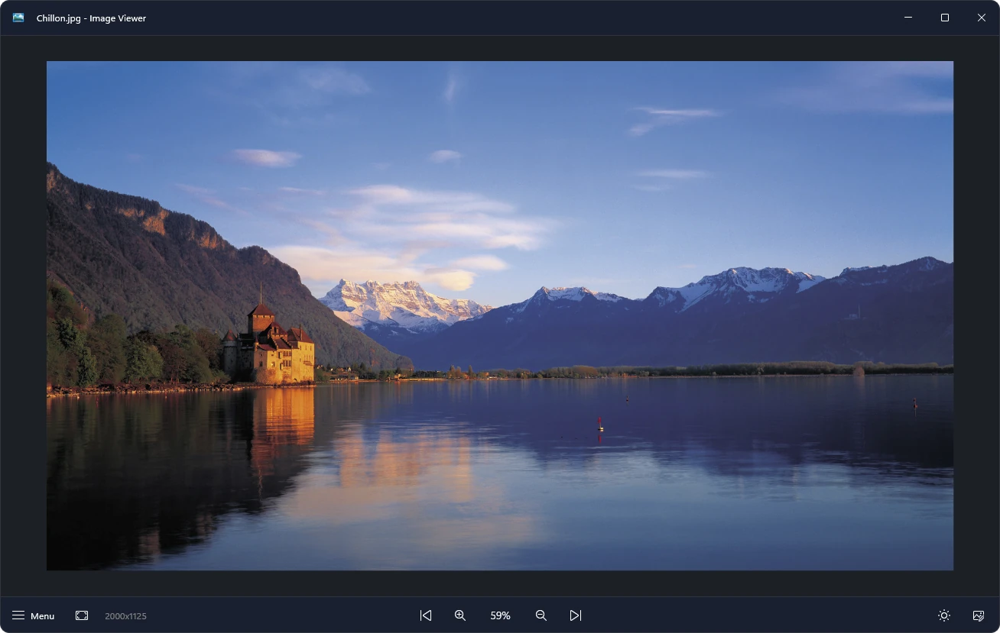

<p align="center">
  
</p>

# Image Viewer for Windows

[](https://github.com/dragonofmercy/image-viewer/releases/latest)
[](https://github.com/dragonofmercy/image-viewer/releases)
[](LICENSE)
[](https://www.rust-lang.org/)
[](https://www.microsoft.com/windows)
[](https://ko-fi.com/dragonofmercy)

Simple image viewer for Windows.  
Image extensions supported: jpg, jpeg, bmp, png, gif, tif, tiff, tga, ico, webp, svg, jxl (JPEG XL), avif, heic and heif. Nothing to install: every format is decoded by the app itself.



## How to build

**Requirements**: Windows 10 1809 or later (x64) and the [Rust](https://rustup.rs/) stable toolchain for MSVC (Visual Studio Build Tools with the C++ workload). No license key is needed.

```pwsh
cargo build --release
```

The runnable exe is `target\release\ImageViewer.exe`. The DLLs from `native\` must stay next to the exe: the C++ runtime is needed to start the app, libheif to open heic, heif and avif files.

## How to install

**Requirements**: Windows 10 1809 or later (x64). The app is self-contained, nothing to install first.

1. Download `Setup.exe` from the [latest release](https://github.com/dragonofmercy/image-viewer/releases).
2. Run `Setup.exe`. Windows SmartScreen will warn that the file is not signed - click **More info** then **Run anyway**.
3. The installer is silent (no wizard). It places the app in `%LOCALAPPDATA%\Dragon.ImageViewer\`, adds a Start Menu shortcut, and launches the app when done.
4. Updates are downloaded and applied automatically from within the app (toast notification when a new version is available, plus a **Check for updates** button in the About dialog).

A portable zip is also published with each release. To uninstall, use **Settings > Apps > Installed apps > Image Viewer > Uninstall**.

## Credits

This project stands on the shoulders of these open-source libraries:

- [Slint](https://slint.dev/) - the user interface toolkit, used under the Slint Royalty-free license
- [image](https://github.com/image-rs/image) - image decoding, encoding and processing
- [jxl-oxide](https://github.com/tirr-c/jxl-oxide) - JPEG XL decoding
- [resvg](https://github.com/linebender/resvg) - SVG rendering
- [libheif](https://github.com/strukturag/libheif) with [libde265](https://github.com/strukturag/libde265) and [aom](https://aomedia.googlesource.com/aom/) - HEIC, HEIF and AVIF decoding
- [Velopack](https://github.com/velopack/velopack) - installer and auto-updates

## AI disclaimer

This application is developed with the help of [Claude Code](https://claude.com/claude-code),
an AI coding assistant. I decide what gets built and review the changes, and every
feature is tested by hand by me before it is released.

## Support

If this project helps to increase your productivity, you can give me a cup of coffee :)

<a href="https://ko-fi.com/dragonofmercy"></a>
